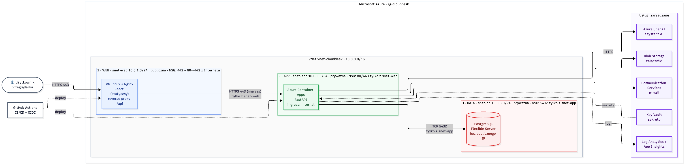
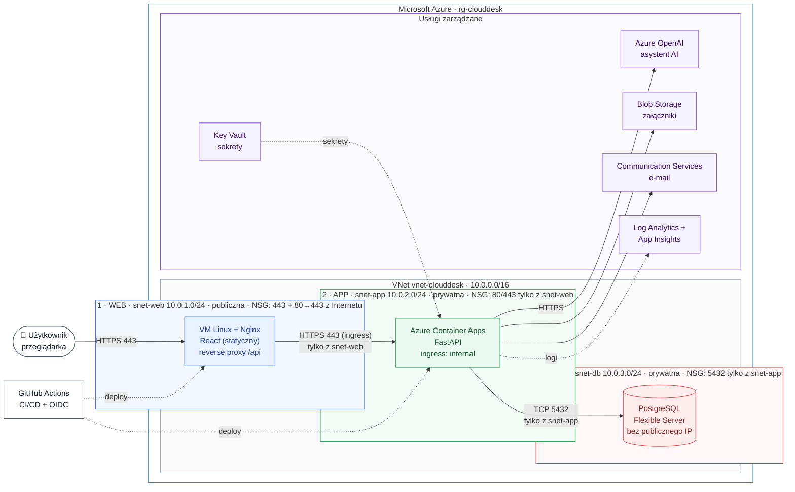

# CloudDesk

**System zgłoszeń IT z SLA i asystentem AI, w trójwarstwowej architekturze w Microsoft Azure.**

Projekt zespołowy „Aplikacja w wybranej chmurze publicznej”, Uniwersytet WSB Merito Wrocław, 2026/2027.

[](https://github.com/qubit-mindless/clouddesk/security/code-scanning)
[](https://github.com/qubit-mindless/clouddesk/actions/workflows/backend-image.yml)

**Live:** http://clouddesk-qubit.polandcentral.cloudapp.azure.com (HTTPS w Bloku 9)

> Status: 🚧 w budowie – Bloki 1–4 gotowe (infrastruktura Azure w Terraformie, frontend w chmurze); w toku Bloki 5–6: API zgłoszeń, model danych i integracja frontendu z API.

## Spis treści
- [O projekcie](#o-projekcie)
- [Zespół](#zespół)
- [Stos technologiczny](#stos-technologiczny)
- [Architektura](#architektura)
- [Wdrożenie w Azure](#wdrożenie-w-azure)
- [Struktura repozytorium](#struktura-repozytorium)
- [Uruchomienie lokalne](#uruchomienie-lokalne)
- [Sposób pracy](#sposób-pracy)
- [Roadmapa](#roadmapa)

## O projekcie
CloudDesk to helpdesk IT oparty na cyklu życia incydentu ITIL.

**Jak działa:**
- Pracownik zgłasza problem. System nadaje mu priorytet (P1–P4) i odlicza czas SLA.
- Technik prowadzi zgłoszenie przez kolejne statusy, a każda zmiana trafia do historii.
- **Asystent AI zaczyna pomagać od razu.** Zanim specjalista przejmie zgłoszenie, asystent oparty na Azure OpenAI analizuje opis problemu i w czacie proponuje kroki naprawcze.
- Jeśli porada pomoże, użytkownik sam zamyka zgłoszenie. Jeśli nie, cała rozmowa z AI trafia do technika jako kontekst.

**Kluczowe funkcje:**
- rejestracja i logowanie z rolami: Zgłaszający, Technik, Administrator;
- CRUD zgłoszeń z walidacją po stronie klienta i serwera;
- statusy ITIL: Nowe → Przypisane → W toku → Rozwiązane → Zamknięte, z pełnym audytem zmian;
- priorytety P1–P4 z terminami SLA i ostrzeżeniem „SLA zagrożone”;
- wyszukiwanie, filtrowanie i paginacja listy zgłoszeń;
- czat z asystentem AI dołączony do każdego zgłoszenia;
- załączniki w Azure Blob Storage i powiadomienia e-mail;
- dashboard SLA: liczba zgłoszeń, MTTR, naruszenia SLA.

## Zespół
| Rola | Osoba | GitHub |
|---|---|---|
| Project Manager / DevOps | Mateusz Fiebich | [@Mateusz5532](https://github.com/Mateusz5532) |
| Frontend | Adam Szymański | [@Adam89528](https://github.com/Adam89528) |
| Backend | Oskar Ernst | [@OskarErsiu](https://github.com/OskarErsiu) |
| Database (DBA) | Bartosz Radziszewski | [@chlopodkwiatow](https://github.com/chlopodkwiatow) |

## Stos technologiczny
| Warstwa | Technologie |
|---|---|
| Frontend | React 19, TypeScript, Vite, Nginx |
| Backend | Python 3.12, FastAPI, Pydantic (DTO), SQLAlchemy 2, Alembic |
| Baza danych | PostgreSQL 16 (Azure Database for PostgreSQL Flexible Server) |
| AI | Azure OpenAI |
| Chmura | Microsoft Azure: VNet, NSG, Virtual Machine, Container Apps, Blob Storage, Key Vault, Communication Services, Log Analytics |
| IaC / CI/CD | Terraform, GitHub Actions (OIDC) |

## Architektura
Trójwarstwowa architektura z izolacją sieciową. Ruch przechodzi kaskadowo przez kolejne warstwy:

| Warstwa | Podsieć | Komponent | Kto może się połączyć |
|---|---|---|---|
| 1. Dostępowa (WEB) | `snet-web` 10.0.1.0/24, **publiczna** | VM z Nginx: frontend React + reverse proxy `/api` | Internet: 80 i 443 (certyfikat i przekierowanie 80 → 443 w Bloku 9) |
| 2. Logiki (APP) | `snet-app` 10.0.2.0/24, **prywatna** | Azure Container Apps: FastAPI | tylko `snet-web`, porty 80/443 (ingress → kontener :8000) |
| 3. Danych (DB) | `snet-db` 10.0.3.0/24, **prywatna** | PostgreSQL Flexible Server | tylko `snet-app`, port 5432 |



*Diagram w wysokiej jakości: [PNG](docs/diagrams/architecture.png) · [SVG](docs/diagrams/architecture.svg). Źródło: [`docs/diagrams/architecture.mmd`](docs/diagrams/architecture.mmd), wykonane w darmowym narzędziu Mermaid.*

*Po zmianie `architecture.mmd` odtwórz obrazy:*
```bash
npx -p @mermaid-js/mermaid-cli mmdc -i docs/diagrams/architecture.mmd -o docs/diagrams/architecture.png -s 4 -b white
npx -p @mermaid-js/mermaid-cli mmdc -i docs/diagrams/architecture.mmd -o docs/diagrams/architecture.svg -b white
```

<details>
<summary>Kod diagramu (Mermaid, renderowany przez GitHub)</summary>


</details>

Diagram pokazuje architekturę docelową. Usługi zarządzane (Azure OpenAI, Blob Storage, Communication Services, Application Insights) i HTTPS dochodzą w kolejnych blokach – aktualny stan jest w sekcji [Wdrożenie w Azure](#wdrożenie-w-azure).

**Wzorce w kodzie:**
- **MVC:** widoki React, routery FastAPI jako kontrolery, modele SQLAlchemy;
- **Repository:** dostęp do bazy wyłącznie przez `app/repositories`;
- **DTO:** schematy Pydantic w `app/schemas`, przenoszące dane między backendem a frontendem.

## Wdrożenie w Azure
Całą infrastrukturę opisuje Terraform w [`terraform/`](terraform/) (szczegóły, reguły NSG i pierwsze uruchomienie: [`terraform/README.md`](terraform/README.md)). Region: `polandcentral`, grupa zasobów `rg-clouddesk`.

| Warstwa | Zasób w Azure | Stan |
|---|---|---|
| Dostęp i koszty | role RBAC zespołu (Contributor tylko na `rg-clouddesk`), budżet 35 €/mies. z alertami 50/80/100% | ✅ |
| Sieć | `vnet-clouddesk` 10.0.0.0/16, podsieci `snet-web` / `snet-app` / `snet-db`, NSG kaskadowo, SSH zamknięty | ✅ |
| WEB | `vm-web` (Ubuntu 24.04, B1s) z Nginx, publiczny IP + DNS `clouddesk-qubit.polandcentral.cloudapp.azure.com` | ✅ |
| APP | Container Apps `cae-clouddesk` (tylko wewnętrzny LB) z `ca-clouddesk-backend`, obraz z GHCR po digeście | ✅ |
| DATA | PostgreSQL 16 Flexible `psql-clouddesk-…` (B1ms) bez dostępu publicznego, hasło w Key Vault | ✅ |
| Migracje | zadanie Container Apps `caj-clouddesk-migrate` (Alembic) | 🚧 po scaleniu modelu danych |

**Jak wdrażamy (do czasu CD w Bloku 8):**
- **Infrastruktura:** `terraform plan` → przegląd planu z kosztami → `terraform apply` (PM/DevOps). Zmiany kodu Terraform przez PR z review.
- **Backend:** każdy merge do `main` w `backend/` buduje obraz `linux/amd64`, skanuje go Trivy (krytyczne podatności i sekrety blokują) i publikuje w `ghcr.io/qubit-mindless/clouddesk-backend`. Nowy digest wpisujemy w `backend_image` w Terraformie.
- **Frontend:** `config/package-web.sh` buduje paczkę, a `config/deploy-web.sh` instaluje ją na VM przez `az vm run-command` – bez otwierania SSH (szczegóły: [`config/README.md`](config/README.md)).
- **Sekrety:** hasło bazy generuje Terraform i trzyma w Key Vault; backend czyta `DATABASE_URL` przez tożsamość zarządzaną. W repozytorium nie ma haseł, kluczy ani ID subskrypcji.

**Koszt (cennik Azure, polandcentral):** ok. 31 €/mies. – VM z dyskiem i publicznym IP ok. 13 €, PostgreSQL B1ms z dyskiem ok. 17 €, prywatne strefy DNS ok. 1 €; Container Apps i logi mieszczą się w darmowych pulach. Bazę można zatrzymać, gdy nie jest potrzebna (`az postgres flexible-server stop`).

## Struktura repozytorium
```
clouddesk/
├── frontend/          # React + Vite (warstwa prezentacji)
├── backend/           # FastAPI (warstwa logiki)
│   └── app/
│       ├── api/routes/    # kontrolery REST
│       ├── core/          # konfiguracja ze zmiennych środowiskowych
│       ├── db/            # połączenie z bazą
│       ├── models/        # modele ORM
│       ├── schemas/       # DTO (Pydantic)
│       ├── repositories/  # wzorzec Repository
│       └── services/      # logika biznesowa (SLA, asystent AI)
├── config/            # konfiguracje lokalne: docker-compose (PostgreSQL), nginx
├── terraform/         # infrastruktura Azure jako kod
├── docs/              # deklaracja, diagramy, dokumentacja
└── .github/           # workflows (obraz backendu + Trivy, Claude Code), Dependabot
```

## Uruchomienie lokalne
Wymagania: Node.js 22.22+ (zalecany 24 LTS), Python 3.12+, Docker.

```bash
# 1. Baza danych
docker compose -f config/docker-compose.yml up -d

# 2. Backend – http://localhost:8000/docs
cd backend
cp .env.example .env
python -m venv .venv && source .venv/bin/activate
pip install -r requirements-dev.txt
alembic upgrade head      # schemat bazy (model danych: docs/database/ERD.md)
python -m app.db.seed     # dane testowe (opcjonalnie)
uvicorn app.main:app --reload

# 3. Frontend – http://localhost:5173
cd frontend
cp .env.example .env.local
npm install
npm run dev
```

Testy i lint:
```bash
cd backend && pytest && ruff check .
cd frontend && npm run lint && npm run build
```

**Konfiguracja:** wyłącznie przez zmienne środowiskowe. Wzory są w plikach `.env.example`. Pliki `.env` nigdy nie trafiają do repozytorium.

## Sposób pracy
- Zadania śledzimy w **GitHub Projects** (kolumny: Todo → In Progress → In Review → Done). Każde zadanie to Issue z przypisaną osobą.
- Każda zmiana powstaje na osobnej gałęzi (`feature/…`, `fix/issue-N`). Potem idzie Pull Request z `Closes #N`, review innej osoby i merge do `main`.
- Commity są małe, a ich opisy czytelne.
- `main` jest chroniony: wymagany 1 approve, a nowy commit w PR kasuje wcześniejsze zatwierdzenia.
- Zależności aktualizuje Dependabot: jeden zbiorczy PR tygodniowo na ekosystem (wersje major podnosimy ręcznie).
- W Issue lub PR można wywołać **Claude Code**, pisząc komentarz `@claude …`.

## Roadmapa
| Blok | Zakres | Status |
|---|---|---|
| 1–2 | Zespół, deklaracja, repo, Kanban, architektura | ✅ |
| 3 | Konto Azure, IAM + MFA, VNet i podsieci, NSG, Terraform | ✅ |
| 4 | Frontend: lista zgłoszeń, hosting w warstwie WEB | ✅ |
| 5 | Backend: CRUD zgłoszeń, walidacja, PostgreSQL | 🚧 baza w Azure gotowa, model danych i API w review/realizacji |
| 6 | Integracja UI ↔ API, stany ładowania i błędów | 🚧 |
| 7–8 | CI (skanery bezpieczeństwa) i CD do Azure | 🚧 obraz backendu z Trivy w CI; CD w planie |
| 9 | Hardening, HTTPS | ⏳ |
| 10 | FinOps, monitoring, /health | ⏳ |
| 11 | Testy API i E2E (Playwright) | ⏳ |
| 12–14 | Code freeze, v1.0.0, dokumentacja, próba generalna | ⏳ |
