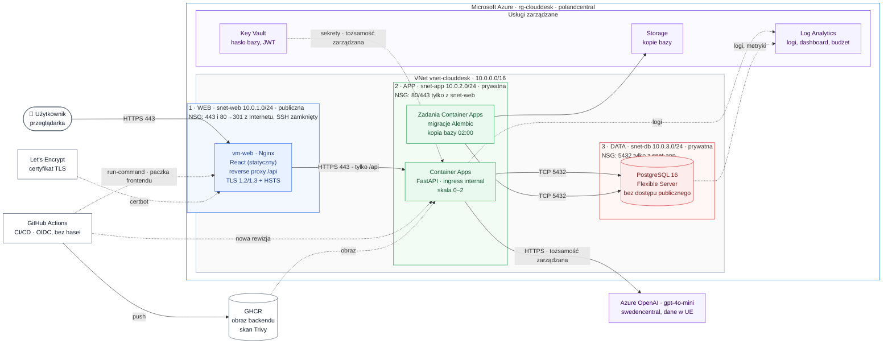

# CloudDesk

**System zgłoszeń IT z SLA i asystentem AI, w trójwarstwowej architekturze w Microsoft Azure.**

Projekt zespołowy „Aplikacja w wybranej chmurze publicznej”, Uniwersytet WSB Merito Wrocław, 2026/2027.

[](https://github.com/qubit-mindless/clouddesk/actions/workflows/ci.yml)
[](https://github.com/qubit-mindless/clouddesk/actions/workflows/deploy.yml)
[](https://github.com/qubit-mindless/clouddesk/security/code-scanning)

**Live:** https://clouddesk-qubit.polandcentral.cloudapp.azure.com · stan wdrożenia (wersja, rewizja, region): [`/status`](https://clouddesk-qubit.polandcentral.cloudapp.azure.com/status)

> Status: aplikacja działa w Azure i wdraża się automatycznie po każdym merge do `main` (CI → obraz → Container Apps → vm-web → testy API i E2E na produkcji). Komplet funkcji v1.0.0, w tym pulpit SLA i oś historii zgłoszenia; od 26.11 code freeze i wersja kandydująca `v1.0.0-rc1`.

## Spis treści
- [O projekcie](#o-projekcie)
- [Zespół](#zespół)
- [Stos technologiczny](#stos-technologiczny)
- [Architektura](#architektura)
- [API](#api)
- [Quick Start](#quick-start)
- [Wdrożenie w Azure](#wdrożenie-w-azure)
- [Bezpieczeństwo](#bezpieczeństwo)
- [Monitoring i FinOps](#monitoring-i-finops)
- [Testy](#testy)
- [CI i bezpieczeństwo kodu](#ci-i-bezpieczeństwo-kodu)
- [Struktura repozytorium](#struktura-repozytorium)
- [Sposób pracy](#sposób-pracy)
- [Roadmapa](#roadmapa)

## O projekcie
CloudDesk to helpdesk IT oparty na cyklu życia incydentu ITIL.

**Cel biznesowy.** W małej firmie zgłoszenia IT giną w mailach i komunikatorach, a nikt nie wie, ile czeka się na pomoc.
CloudDesk zbiera je w jednym miejscu, pilnuje terminów SLA według priorytetu i odciąża techników: proste problemy
zgłaszający rozwiązuje sam z pomocą asystenta AI, a technik dostaje zgłoszenie razem z tym, co już sprawdzono.

**Jak działa:**
- Pracownik zgłasza problem i wybiera, jak jest pilny (P1–P4). System odlicza czas SLA.
- **Asystent AI odpowiada od razu po wysłaniu.** Oparty na Azure OpenAI, analizuje opis i proponuje kroki naprawcze.
- Jeśli porada pomoże, zgłaszający jednym przyciskiem zamyka zgłoszenie („Pomogło”). Jeśli nie, technik dostaje je razem z rozmową.
- Technik prowadzi zgłoszenie przez kolejne statusy, a każda zmiana trafia do historii.

**Kluczowe funkcje:**
- logowanie z rolami: Zgłaszający, Technik, Administrator (konta zakłada administrator; na prezentacji – przyciski kont demo);
- zgłaszający: „Moje zgłoszenia” jako karty z etapem i terminem odpowiedzi, formularz z priorytetem opisanym po ludzku;
- technik: lista z filtrami, wyszukiwaniem i paginacją, powitanie z licznikami (moje, po terminie, blisko terminu, dziś),
  „Aktywność na żywo” i karta „Asystent AI dziś” (ile problemów rozwiązano bez technika);
- CRUD zgłoszeń z walidacją po stronie klienta i serwera; statusy ITIL: Nowe → Przypisane → W toku → Rozwiązane → Zamknięte, z pełnym audytem zmian;
- priorytety P1–P4 z terminami SLA i ostrzeżeniem „SLA zagrożone”;
- powiadomienia w aplikacji (dzwonek): przypisanie, nowe P1, przekroczone SLA, zmiana statusu mojego zgłoszenia;
- czat zgłaszającego z asystentem AI; technik widzi rozmowę do odczytu;
- publiczna strona `/status`: wersja frontendu i backendu, rewizja, region, stan bazy i asystenta;
- pulpit SLA dla technika i administratora (`/dashboard`, 7/30/90 dni): zgłoszenia zagrożone i po terminie z odliczaniem, zgodność z SLA liczona z zakończonych, MTTR, trend utworzonych i rozwiązanych, otwarte według priorytetu, obciążenie techników, odpowiedzi asystenta AI;
- w toku przed v1.0.0: oś historii zgłoszenia (#139).

## Zespół
| Rola | Osoba | GitHub |
|---|---|---|
| Project Manager / DevOps | Mateusz Fiebich | [@Mateusz5532](https://github.com/Mateusz5532) |
| Frontend | Adam Szymański | [@Adam89528](https://github.com/Adam89528) |
| Backend | Oskar Ernst | [@OskarErsiu](https://github.com/OskarErsiu) |
| Database (DBA) | Bartosz Radziszewski | [@chlopodkwiatow](https://github.com/chlopodkwiatow) |

**Rola PM (Mateusz):** planowanie etapów i tablicy Kanban, podział zadań na Issues, przegląd i zatwierdzanie PR-ów,
infrastruktura Azure w Terraformie, pipeline CI/CD i bezpieczeństwo chmury, sprawozdania i prezentacja.

## Stos technologiczny
| Warstwa | Technologie |
|---|---|
| Frontend | React 19, TypeScript, Vite, Nginx |
| Backend | Python 3.12, FastAPI, Pydantic (DTO), SQLAlchemy 2, Alembic |
| Baza danych | PostgreSQL 16 (Azure Database for PostgreSQL Flexible Server) |
| AI | Azure OpenAI |
| Chmura | Microsoft Azure: VNet, NSG, Virtual Machine, Container Apps (aplikacja i zadania), PostgreSQL Flexible Server, Key Vault, Azure OpenAI, Storage (kopie bazy), Log Analytics, Budgets |
| IaC / CI/CD | Terraform, GitHub Actions (OIDC) |

## Architektura
Trójwarstwowa architektura z izolacją sieciową. Ruch przechodzi kaskadowo przez kolejne warstwy:

| Warstwa | Podsieć | Komponent | Kto może się połączyć |
|---|---|---|---|
| 1. Dostępowa (WEB) | `snet-web` 10.0.1.0/24, **publiczna** | VM z Nginx: frontend React + reverse proxy `/api` | Internet: 443 (TLS, certyfikat Let's Encrypt) i 80 (tylko przekierowanie 301 na HTTPS) |
| 2. Logiki (APP) | `snet-app` 10.0.2.0/24, **prywatna** | Azure Container Apps: FastAPI | tylko `snet-web`, porty 80/443 (ingress → kontener :8000) |
| 3. Danych (DB) | `snet-db` 10.0.3.0/24, **prywatna** | PostgreSQL Flexible Server | tylko `snet-app`, port 5432 |

Diagram (Mermaid – GitHub rysuje go bezpośrednio z kodu poniżej; ten sam kod: [`docs/diagrams/architecture.mmd`](docs/diagrams/architecture.mmd)):



**Wzorce w kodzie:**
- **MVC:** widoki React, routery FastAPI jako kontrolery, modele SQLAlchemy;
- **Repository:** dostęp do bazy wyłącznie przez `app/repositories`;
- **DTO:** schematy Pydantic w `app/schemas`, przenoszące dane między backendem a frontendem.

## API
Dokumentacja interaktywna (OpenAPI): `http://localhost:8000/docs` lokalnie. W Azure API jest dostępne wyłącznie przez Nginx pod `/api` (backend nie ma publicznego adresu). Zgłoszenie (`Ticket`) ma obok loginów `reporter`/`assignee` także imiona i nazwiska do wyświetlenia: `reporterName`, `assigneeName` (`null`, gdy nieprzypisane). JSON w camelCase; błędy walidacji w formacie FastAPI: `{"detail": [{"loc": ["body", "<pole>"], "msg": "…"}]}`.

Błędy zawsze jako JSON `{"detail": "…"}`, bez śladu stosu i szczegółów bazy (szczegóły tylko w logu kontenera):
- **422** – także tekst ze znakiem NUL (`\u0000`) albo pojedynczym surogatem Unicode (PostgreSQL ich nie zapisze); limity długości liczone w znakach, zgodnie z kolumnami bazy;
- **503** + nagłówek `Retry-After: 10` – baza chwilowo niedostępna (każdy endpoint korzystający z bazy, poza `/health`, który zwraca swój stan);
- **500** – nieoczekiwany błąd serwera.

| Metoda | Ścieżka | Opis | Odpowiedzi | Autoryzacja |
|---|---|---|---|---|
| GET | `/health`, `/api/health` | stan aplikacji i połączenia z bazą, wersja i SHA wdrożonego commita (`commit`; lokalnie `local`), rewizja, replika i region Container Apps, czas startu, stan asystenta AI – dla strony `/status`; z zewnątrz przez Nginx tylko `/api/health`; `/health` służy też monitoringowi | 200, 503 | – |
| GET | `/health/live` | czy proces backendu odpowiada (bez sprawdzania bazy) – sonda startup, liveness i readiness Container Apps; tylko wewnątrz VNet | 200 | – |
| POST | `/api/auth/login` | logowanie: `email`, `password` → `accessToken` (JWT, ważny 60 min), `tokenType`, `expiresIn`, `user` (`id`, `email`, `login`, `fullName`, `role`) | 200, 401, 422 | – |
| GET | `/api/auth/me` | zalogowany użytkownik | 200, 401 | token |
| GET | `/api/tickets` | lista zgłoszeń; filtry `status`, `priority`, `assignee` (login technika), `q` (tytuł); paginacja `page`, `size` (1–100). REPORTER widzi tylko swoje | 200, 401, 422 | token |
| GET | `/api/tickets/{id}` | szczegóły zgłoszenia (cudze dla REPORTER → 404) | 200, 401, 404 | token |
| GET | `/api/tickets/{id}/history` | oś historii: zmiany pól od najstarszej (`changedAt`, przy równym czasie `id`). `items`: `id`, `field` (`status`, `priority`, `assignee`, `title`, `description`, `resolution`), `oldValue`, `newValue` (kody statusu/priorytetu, login technika, `null` = brak), `author` (login), `authorName`, `changedAt`. Utworzenia nie ma w historii – to `createdAt` i `reporter` zgłoszenia. Widoczność jak przy zgłoszeniu (cudze dla REPORTER → 404) | 200, 401, 404, 422 | token |
| POST | `/api/tickets` | nowe zgłoszenie: `title` (5–200 znaków), `description`, `priority` (P1–P4); zgłaszający = zalogowany, status `NEW` i termin SLA nadaje backend | 201, 401, 422 | token |
| PATCH | `/api/tickets/{id}` | zmiana wybranych pól: `title`, `description`, `priority` (przelicza SLA), `status`, `assignee` (login technika lub `null`); każda zmiana trafia do historii z autorem. REPORTER: tylko treść i priorytet własnego zgłoszenia | 200, 401, 403, 404, 422 | token |
| POST | `/api/tickets/{id}/resolve` | „Pomogło – zamknij zgłoszenie”: zgłaszający zamyka **własne** zgłoszenie po pomocy asystenta AI (ciało `{}`); status `RESOLVED`, `resolvedAt` = teraz, w historii wiersze `status` i `resolution` (`SELF_AI`). 403 – technik/administrator (zamykają przez PATCH `status`); cudze → 404; już rozwiązane/zamknięte albo bez żadnej odpowiedzi asystenta w zgłoszeniu → 409 | 200, 401, 403, 404, 409, 422 | token, REPORTER |
| DELETE | `/api/tickets/{id}` | usunięcie zgłoszenia razem z historią, komentarzami i załącznikami | 204, 401, 403, 404 | token, TECHNICIAN/ADMIN |
| GET | `/api/tickets/{id}/assistant` | rozmowa zgłaszającego z asystentem AI: `items` (`role` user/assistant, `content`, `createdAt`), `enabled`, `remaining` (ile odpowiedzi zostało), `canAsk`, `readOnlyReason` (`not_reporter` – technik/administrator widzi rozmowę do odczytu, `resolved` – zgłoszenie rozwiązane) | 200, 401, 404 | token |
| POST | `/api/tickets/{id}/assistant` | pytanie do asystenta – **tylko osoba zgłaszająca**, dopóki zgłoszenie nie jest rozwiązane: `{"message": "…"}` (1–1000 znaków) albo `{}` = pierwsze wskazówki; zwraca całą rozmowę. 403 – technik/administrator (cudze zgłoszenie); 409 – zgłoszenie rozwiązane/zamknięte albo ta sama replika backendu właśnie odpowiada w tym zgłoszeniu (limit i tak jest sprawdzany w bazie) | 200, 401, 403, 404, 409, 422, 429, 503 | token |
| GET | `/api/activity` | „Aktywność na żywo”: ostatnie zdarzenia w widocznych zgłoszeniach (REPORTER – tylko swoje), sort od najnowszych; `limit` 1–50 (domyślnie 20). `items`: `id` (`h-`/`t-`/`a-` + id wiersza), `kind` (`change` – zmiana z historii, `created` – utworzenie z priorytetem, `ai` – odpowiedź asystenta), `ticketId`, `ticketTitle`, `actor`, `actorName`, `field`, `oldValue`, `newValue`, `at`. Bez treści opisów i wiadomości AI (zmiana opisu – tylko fakt zmiany) | 200, 401, 422 | token |
| GET | `/api/notifications` | dzwonek: powiadomienia z ostatnich 7 dni (najwyżej 20, od najnowszych), wyliczane z historii i zgłoszeń, bez własnych zmian użytkownika. `kind`: `assigned` (ktoś inny przypisał mi zgłoszenie), `new_p1` (zgłoszenie utworzone jako P1 – technicy i administratorzy), `sla_breached` (otwarte po terminie: przypisany technik, a nieprzypisane – technicy i administratorzy), `status` i `taken` (zmiana statusu / przypisanie technika w moim zgłoszeniu; REPORTER dostaje tylko te dwa). Pola: `id`, `kind`, `ticketId`, `ticketTitle`, `actorName`, `value`, `at`, `unread`; `unread` w odpowiedzi = liczba nieprzeczytanych | 200, 401 | token |
| POST | `/api/notifications/read` | oznacza powiadomienia jako przeczytane: ciało `{}` albo `{"until": "<at najnowszego pokazanego powiadomienia>"}` (ISO 8601 ze strefą); zapisuje `min(until, teraz)` w `users.notifications_seen_at` (znacznik się nie cofa), powiadomienia z `at` ≤ znacznika mają `unread: false` | 204, 401, 422 | token |
| GET | `/api/stats` | pulpit SLA; okno = `days` dni kalendarzowych w strefie Europe/Warsaw (7–90, domyślnie 30), ostatni = dziś. `byStatus` (wszystkie zgłoszenia), `byPriority` (otwarte), `sla` (`open`, `breachedOpen` – po terminie, `atRisk` – zostało < 25% czasu SLA, `resolved` i `resolvedOnTime` – rozwiązane/zamknięte w oknie, `compliancePct` – **tylko z zakończonych**, `null` bez danych), `mttrHours` (średni czas rozwiązania), `perTechnician` (`login`, `fullName`, `open`, `resolved`), `daily` (`days` pozycji `date`/`created`/`resolved`), `ai` (`answers`, `tickets`), `atRiskTop` (do 5 otwartych po terminie lub zagrożonych, od najbliższego terminu); do porównania ↑↓: `previous` (`compliancePct`, `mttrHours`, `aiAnswers` z poprzedniego okresu tej samej długości) i `openWeekAgo` (otwarte 7 dni temu, z historii statusu) | 200, 401, 403, 422 | token, TECHNICIAN/ADMIN |
| GET | `/api/me/summary` | liczniki do powitania na pulpicie; „dziś” = dzień w strefie Europe/Warsaw. `mine` – technik/administrator: przypisane do mnie i otwarte, zgłaszający: moje otwarte (`open`, `breached` – po terminie, `atRisk` – przed terminem, zostało < 25% czasu SLA, `nextDueAt` – najbliższy termin przed upływem albo `null`). Tylko technik i administrator (dla REPORTER `null`): `team` (`breached`, `atRisk` wśród wszystkich otwartych, `createdToday`, `resolvedToday`, `last7Days` – 7 dni `date`/`created`/`resolved`, ostatni = dziś) i `aiToday` (`conversations` – zgłoszenia z odpowiedzią asystenta dziś, `resolvedByReporter` – z nich zamknięte dziś przez `/resolve`, `handedOver` = różnica, `answers` – odpowiedzi dziś) | 200, 401 | token |

Termin SLA od utworzenia zgłoszenia: P1 – 4 h, P2 – 8 h, P3 – 2 dni, P4 – 5 dni.

**Logowanie i role.** Token przekazujemy w nagłówku `Authorization: Bearer <accessToken>`. Brak, wygasły albo podrobiony token → 401 (`WWW-Authenticate: Bearer`); rola bez uprawnień → 403.

| Rola | Zgłoszenia | Zmiany | Usuwanie |
|---|---|---|---|
| REPORTER | tylko własne | treść i priorytet własnych | – |
| TECHNICIAN | wszystkie | wszystkie pola, w tym status i przypisanie | ✓ |
| ADMIN | wszystkie | wszystkie pola | ✓ |

- **Hasła:** skrót argon2id; ta sama odpowiedź 401 dla nieznanego e-maila i złego hasła (także w czasie odpowiedzi).
- **Tokeny:** JWT HS256 podpisany kluczem `JWT_SECRET`. W Azure klucz jest w Key Vault (`jwt-secret`), a bez niego backend nie wystartuje. Użytkownik jest odczytywany z bazy przy każdym żądaniu, więc usunięte konto traci dostęp od razu.
- **Asystent AI:** pierwsza linia pomocy dla osoby zgłaszającej – podpowiada, co sprawdzić samodzielnie, a technik czyta tę rozmowę przed przejęciem zgłoszenia (sam nie pisze do asystenta). Rozmowa jest otwarta do rozwiązania zgłoszenia. Azure OpenAI (`gpt-4o-mini`), wywoływany z backendu przez REST z tożsamością zarządzaną (bez klucza). Limit 10 odpowiedzi na zgłoszenie, timeout 30 s, treść zgłoszenia przekazywana modelowi jako dane, nie polecenia. Awaria usługi → 503 z komunikatem, a pytanie nie zostaje zapisane. Treść rozmów nie trafia do logów.
- **Konta demo** z seeda: `admin@`, `tech.jan@`, `tech.ola@`, `anna.k@`… `clouddesk.example`, wspólne hasło z `DEMO_PASSWORD`. W Azure hasło jest w Key Vault (`demo-password`); odczyt: `terraform output demo_password_hint`.

## Quick Start
Wymagania: Git, Docker, Python 3.12+, Node.js 22.22+ (zalecany 24 LTS). Cała aplikacja lokalnie w ok. 5 minut:

```bash
git clone https://github.com/qubit-mindless/clouddesk.git
cd clouddesk

# 1. Baza danych – PostgreSQL 16 w Dockerze
docker compose -f config/docker-compose.yml up -d

# 2. Backend – http://localhost:8000/docs (pierwszy terminal)
cd backend
cp .env.example .env              # wpisz DEMO_PASSWORD=<dowolne hasło> – hasło kont demo
python3 -m venv .venv && source .venv/bin/activate
pip install -r requirements.txt
alembic upgrade head              # schemat bazy (model danych: docs/database/ERD.md)
python -m app.db.seed             # konta demo i przykładowe zgłoszenia
python -m app.db.seed_demo        # opcjonalnie: ok. 90 zgłoszeń z 30 dni (pulpit SLA, trend, aktywność)
uvicorn app.main:app --reload

# 3. Frontend – http://localhost:5173 (drugi terminal, z katalogu clouddesk/)
cd frontend
cp .env.example .env.local        # VITE_DEMO_ACCOUNTS=true – przyciski kont demo na ekranie logowania
npm install
npm run dev
```

Logowanie: `tech.jan@clouddesk.example` (Technik), `anna.k@clouddesk.example` (Zgłaszający) albo `admin@clouddesk.example`,
hasło = `DEMO_PASSWORD` z `backend/.env`. Asystent AI lokalnie jest wyłączony (pusty `AZURE_OPENAI_ENDPOINT`) – reszta działa jak w chmurze.

**Najszybciej (ok. 1 minuty, bez Dockera i Pythona) – sam frontend z udawanym API:** w kroku 3 ustaw w `frontend/.env.local`
`VITE_FAKE_API=true`. Wtedy `npm run dev` odpowiada na `/api/...` udawanym API (`frontend/dev/fakeApi.ts`) w formacie
z [`docs/api-kontrakty.md`](docs/api-kontrakty.md), z tymi samymi statusami i błędami 422 co FastAPI. Dane siedzą w pamięci
i znikają po restarcie serwera. Logowanie: te same konta demo z dowolnym niepustym hasłem; restart serwera unieważnia tokeny.

**Konfiguracja:** wyłącznie przez zmienne środowiskowe. Wzory są w plikach `.env.example` (`backend/`, `frontend/`, `tests/`,
`config/web.env.example`); pliki `.env` nigdy nie trafiają do repozytorium.

**Wdrożenie (CI/CD):** merge do `main` → CI (Gitleaks, lint, testy, migracje, Trivy) → obraz backendu → Deploy do Azure
(sekcja [Wdrożenie w Azure](#wdrożenie-w-azure)).

Testy i lint:
```bash
cd backend && pytest && ruff check .
cd frontend && npm run lint && npm run build
```

## Wdrożenie w Azure
Całą infrastrukturę opisuje Terraform w [`terraform/`](terraform/) (szczegóły, reguły NSG i pierwsze uruchomienie: [`terraform/README.md`](terraform/README.md)). Region: `polandcentral`, grupa zasobów `rg-clouddesk`.

| Warstwa | Zasób w Azure | Stan |
|---|---|---|
| Dostęp i koszty | role RBAC zespołu (Contributor tylko na `rg-clouddesk`), budżet 35 €/mies. z alertami 50/80/100% | ✅ |
| Sieć | `vnet-clouddesk` 10.0.0.0/16, podsieci `snet-web` / `snet-app` / `snet-db`, NSG kaskadowo, SSH zamknięty | ✅ |
| WEB | `vm-web` (Ubuntu 24.04, B1s) z Nginx, publiczny IP + DNS `clouddesk-qubit.polandcentral.cloudapp.azure.com`; HTTPS z certyfikatem Let's Encrypt (certbot, odnawianie automatyczne), HTTP → 301 na HTTPS, HSTS | ✅ |
| APP | Container Apps `cae-clouddesk` (tylko wewnętrzny LB) z `ca-clouddesk-backend`, obraz z GHCR po digeście | ✅ |
| DATA | PostgreSQL 16 Flexible `psql-clouddesk-…` (B1ms) bez dostępu publicznego, hasło w Key Vault | ✅ |
| AI | Azure OpenAI `oai-clouddesk-…` z modelem `gpt-4o-mini` (DataZoneStandard – dane w UE), dostęp backendu tożsamością zarządzaną, bez kluczy | ✅ |
| Migracje | zadanie Container Apps `caj-clouddesk-migrate` (Alembic), uruchamiane `scripts/azure-migrate.sh` (opcje `--seed`, `--seed-demo`) | ✅ schemat 6 tabel + dane przykładowe |

**Jak wdrażamy:**
- **Infrastruktura:** `terraform plan` → przegląd planu z kosztami → `terraform apply` (PM/DevOps). Zmiany kodu Terraform przez PR z review.
- **Aplikacja – automatycznie po każdym merge do `main`** (workflow **Deploy**, `.github/workflows/deploy.yml`, uruchamiany po zielonym CI;
  logowanie do Azure przez OIDC, bez haseł):
  1. **Obraz backendu:** build `linux/amd64`, skan Trivy (krytyczne podatności i sekrety blokują), publikacja w GHCR z tagiem `sha-<commit>`.
  2. **Backend:** migracje bazy (`alembic upgrade head` w zadaniu Container Apps), potem nowa rewizja Container Apps z tym obrazem.
  3. **Frontend:** build z SHA commita w stopce, paczka na `vm-web` przez `az vm run-command` w kawałkach (`config/web-run-scripts.sh`,
     bez SSH), sprawdzenie z zewnątrz: HTTP → HTTPS, certyfikat, strona i `/api/health` z wdrożonym SHA.
  4. **Testy API (Jest + Supertest) i E2E (Playwright)** na wdrożonej aplikacji.

  Ręcznie: [`config/README.md`](config/README.md) (frontend), `scripts/azure-migrate.sh [--seed | --seed-demo]` (migracje, konta demo i przykładowe zgłoszenia; `--seed-demo` dodaje ok. 90 zgłoszeń z 30 dni, tylko gdy w bazie jest mniej niż 60 zgłoszeń).
- **Sekrety:** hasło bazy generuje Terraform i trzyma w Key Vault; backend czyta `DATABASE_URL` przez tożsamość zarządzaną. W repozytorium nie ma haseł, kluczy ani ID subskrypcji.

**Koszt (cennik Azure, polandcentral, ceny katalogowe bez darmowych limitów):** ok. 31 €/mies. – VM z dyskiem i publicznym IP ok. 13 €, PostgreSQL B1ms z dyskiem ok. 17 €, prywatne strefy DNS ok. 1 €; Container Apps i logi mieszczą się w darmowych pulach. Faktycznie płacimy mniej, bo VM B1s i PostgreSQL B1ms mieszczą się w darmowych limitach subskrypcji studenckiej – rzeczywisty koszt: sekcja [Monitoring i FinOps](#monitoring-i-finops). Bazę można zatrzymać, gdy nie jest potrzebna (`az postgres flexible-server stop`).

## Bezpieczeństwo
Ruch płynie wyłącznie kaskadowo: **Internet → WEB → APP → DATA**. Każda warstwa ma własną podsieć i własną NSG, a każda NSG kończy się regułą `DenyVnetInBound`. Ta reguła wyłącza domyślne `AllowVnetInBound` Azure, więc np. `vm-web` nie połączy się z bazą z pominięciem backendu. Reguły opisuje [`terraform/network.tf`](terraform/network.tf), a tabela poniżej jest ich odzwierciedleniem.

**Przyjęte pasma priorytetów:** 100–199 to reguły Allow, 200–299 to jawne Deny z Internetu, a 4000 to `DenyVnetInBound`. Reguły Azure o priorytetach 65000+ są domyślne.

### Reguły przychodzące (Inbound)
| Warstwa / NSG | Priorytet | Reguła | Źródło | Porty | Akcja | Po co |
|---|---|---|---|---|---|---|
| WEB `nsg-web` | 100 | `AllowHttpsFromInternet` | Internet | 443 | ✅ Allow | strona i API przez Nginx po HTTPS |
| WEB `nsg-web` | 110 | `AllowHttpFromInternet` | Internet | 80 | ✅ Allow | tylko przekierowanie 301 na HTTPS i wyzwania ACME Let's Encrypt |
| WEB `nsg-web` | 200 | `DenyMgmtFromInternet` | Internet | 22, 3389 | ⛔ Deny | SSH/RDP zamknięte; maszynę obsługujemy przez `az vm run-command` |
| WEB `nsg-web` | 4000 | `DenyVnetInBound` | VirtualNetwork | * | ⛔ Deny | brak ruchu z innych podsieci do warstwy WEB |
| APP `nsg-app` | 100 | `AllowIngressFromWeb` | `snet-web` 10.0.1.0/24 | 80, 443, 31080, 31443 | ✅ Allow | Nginx → wewnętrzny load balancer Container Apps (80/443) → proxy środowiska (31080/31443) → kontener :8000 |
| APP `nsg-app` | 110 | `AllowIntraSubnet` | `snet-app` 10.0.2.0/24 | * | ✅ Allow | ruch wewnątrz środowiska Container Apps (proxy, repliki, zadania migracji i kopii) |
| APP `nsg-app` | 120 | `AllowAzureLoadBalancer` | AzureLoadBalancer | * | ✅ Allow | sondy zdrowia load balancera Azure |
| APP `nsg-app` | 200 | `DenyMgmtAndAppFromInternet` | Internet | 22, 3389, 80, 443, 31080, 31443, 8000, 8080 | ⛔ Deny | porty zarządcze, ingressu i kontenera zamknięte, gdyby kiedyś pojawił się publiczny adres |
| APP `nsg-app` | 4000 | `DenyVnetInBound` | VirtualNetwork | * | ⛔ Deny | np. `snet-db` nie łączy się z backendem |
| DATA `nsg-db` | 100 | `AllowPostgresFromApp` | `snet-app` 10.0.2.0/24 | 5432 | ✅ Allow | jedyna droga do bazy: backend i zadania Container Apps |
| DATA `nsg-db` | 200 | `DenyDbPortsFromInternet` | Internet | 3306, 5432 | ⛔ Deny | porty baz danych zamknięte dla Internetu |
| DATA `nsg-db` | 4000 | `DenyVnetInBound` | VirtualNetwork | * | ⛔ Deny | `snet-web` nie łączy się z bazą bezpośrednio |
| wszystkie | 65001 / 65500 | `AllowAzureLoadBalancerInBound`, `DenyAllInBound` | – | * | domyślne Azure | wszystko, czego nie dopuszczono wyżej, jest odrzucane |

### Reguły wychodzące (Outbound)
Nie dodajemy własnych reguł wychodzących, więc działają domyślne reguły Azure w każdej NSG: `AllowVnetOutBound` (65000), `AllowInternetOutBound` (65001) i `DenyAllOutBound` (65500). Ruch wychodzący, którego warstwy faktycznie potrzebują:

| Warstwa | Cel | Porty | Po co |
|---|---|---|---|
| WEB `vm-web` | `snet-app` (wewnętrzny LB Container Apps) | 80, 443 | proxy `/api` do backendu |
| WEB `vm-web` | Internet | 80, 443 | aktualizacje systemu (apt), certbot i Let's Encrypt (wydanie i odnowienie certyfikatu) |
| APP backend i zadania | `snet-db` | 5432 | PostgreSQL |
| APP backend i zadania | Internet / usługi Azure | 443 | pobranie obrazu z GHCR, Key Vault (sekrety przez tożsamość zarządzaną), Entra ID, Azure OpenAI (asystent AI) |
| wszystkie | 168.63.129.16 | 53 | DNS platformy Azure (prywatne strefy bazy i Container Apps); dozwolony przez domyślne reguły wychodzące – nie blokujemy go, bo bez niego nie działa DNS ani sondy |
| DATA | – | – | baza tylko odpowiada na połączenia z `snet-app`, sama ich nie nawiązuje |

Znane ograniczenie: wyjście do Internetu nie jest zawężone do konkretnych adresów. Wymagałoby to Azure Firewall albo NAT z listą dozwolonych FQDN, a koszt nie mieści się w budżecie projektu. Container Apps potrzebuje też wyjścia do usług platformy.

### Pozostałe zabezpieczenia
- **HTTPS:** Nginx na `vm-web` obsługuje TLS 1.2 i 1.3 z certyfikatem Let's Encrypt, który `certbot` odnawia automatycznie. Port 80 zwraca `301` na ten sam adres po HTTPS (z zachowaniem ścieżki i parametrów), a nagłówek HSTS każe przeglądarce zostać przy HTTPS. Frontend wywołuje API przez względną ścieżkę `/api`, więc wszystkie żądania idą tym samym, szyfrowanym połączeniem. Pipeline CD po każdym wdrożeniu sprawdza przekierowanie i ważność certyfikatu.
- **Brak SSH:** port 22 nie jest otwarty w żadnej podsieci. Wdrożenia i administracja `vm-web` idą przez `az vm run-command` (Azure control plane), a GitHub Actions loguje się do Azure przez OIDC, bez haseł w repozytorium.
- **Backend bez publicznego adresu:** środowisko Container Apps ma tylko wewnętrzny load balancer. Z Internetu backend jest osiągalny wyłącznie przez Nginx, i to tylko pod `/api/...`.
- **Baza bez dostępu publicznego:** `public_network_access_enabled = false` w `terraform/database.tf` (w portalu „Dostęp publiczny: wyłączony”), adres tylko w `snet-db`, a nazwa rozwiązuje się wyłącznie w prywatnej strefie DNS VNet.
- **Sekrety w Key Vault:** hasło bazy, `DATABASE_URL` i klucz podpisu tokenów JWT (#106) generuje Terraform i trzyma w Key Vault. Backend czyta je przez tożsamość zarządzaną (rola Key Vault Secrets User). W repozytorium nie ma haseł, kluczy ani adresów środowisk, a Gitleaks pilnuje tego w CI.
- **Limit prób logowania:** Nginx przepuszcza najwyżej 10 prób `POST /api/auth/login` na minutę z jednego adresu (10 na zapas), ponad limit – 429.
  Liczy po ścieżce znormalizowanej przez Nginx (`$uri`), więc warianty typu `/api/auth/%6Cogin` czy `//api/auth/login` też są liczone.
- **Konta demo na ekranie logowania** (`VITE_DEMO_ACCOUNTS=true`): przyciski tylko wpisują e-mail – hasło (`demo-password` z Key Vault) trzeba podać.
- **Nagłówki HTTP:** `X-Content-Type-Options: nosniff`, `X-Frame-Options: DENY`, `Referrer-Policy: strict-origin-when-cross-origin`, `Strict-Transport-Security`, bez wersji Nginx (`server_tokens off`).

## Monitoring i FinOps

### Budżet i alerty kosztów
Budżet `budget-clouddesk-monthly` (Terraform: [`terraform/budget.tf`](terraform/budget.tf)) obejmuje grupę zasobów `rg-clouddesk`, odnawia się co miesiąc i wynosi **35 €**.

| Próg | Rodzaj | Kto dostaje e-mail |
|---|---|---|
| 50% (17,50 €) | faktyczny koszt | cały zespół (4 osoby) |
| 80% (28 €) | faktyczny koszt – czas sprawdzić, które zasoby rosną | cały zespół |
| 100% (35 €) | faktyczny koszt | cały zespół |
| 100% | **prognoza** – ostrzeżenie, zanim budżet zostanie przekroczony | cały zespół |

Adresy zespołu są w `terraform.tfvars` (poza repozytorium). Koszt w listopadzie 2026 (stan na 24.11): **5,17 €**, prognoza na cały miesiąc: ok. **6,50 €**.

Większość kosztu to publiczny adres IP i sieć, Storage (stan Terraformu, kopie bazy) oraz strefy DNS. VM B1s, PostgreSQL B1ms i Log Analytics mieszczą się w darmowych limitach subskrypcji studenckiej.

Jak trzymamy koszty w ryzach:
- backend skaluje się do zera, gdy nie ma ruchu (`min_replicas = 0`);
- logi mają dzienny limit 0,15 GB i retencję 30 dni;
- asystent AI ma limit 10 odpowiedzi na zgłoszenie;
- przed każdym `terraform apply` sprawdzamy plan i ceny nowych zasobów.

### Endpoint `/health`
`GET /health` (wewnątrz VNet) i `GET /api/health` (z zewnątrz przez Nginx) odpytują bazę (`SELECT 1`) i zwracają:

```json
{"status": "UP", "database": "CONNECTED", "version": "0.1.0", "commit": "<SHA wdrożonego commita>", "timestamp": "…",
 "revision": "ca-clouddesk-backend--…", "replica": "…", "region": "polandcentral", "startedAt": "…", "assistant": "ENABLED"}
```

`revision` i `replica` ustawia Container Apps, `region` – Terraform (`APP_REGION`); poza Azure są `null`. `assistant` mówi tylko,
czy asystent jest skonfigurowany (bez wywołania modelu). Celowo nie zwracamy nazwy hosta, domeny środowiska, adresów IP z VNet
ani niczego z `DATABASE_URL`. Te dane pokazuje publiczna strona **`/status`** (link w stopce): wersje frontendu i backendu
z linkami do commitów, warstwy Internet → Nginx → Container Apps → PostgreSQL, czas odpowiedzi mierzony w przeglądarce,
komunikat o wybudzeniu backendu ze skali 0 (gdy odpowiedź trwa > 5 s) i koszty z sekcji FinOps.

Gdy baza nie odpowiada, odpowiedź to **503** z `"status": "DOWN", "database": "DISCONNECTED"`.
- Pipeline CD po każdym wdrożeniu sprawdza `/api/health`, w tym czy `commit` to wdrożony SHA.
- Sondy startup, liveness i readiness Container Apps: `/health/live` (bez bazy).

### Logi w chmurze
Wszystkie logi trafiają do jednego workspace **Log Analytics** `log-clouddesk` (retencja 30 dni). Nie trzeba logować się na VM ani do kontenera.

| Źródło | Tabela | Co tam jest |
|---|---|---|
| Backend (Container Apps) | `ContainerAppConsoleLogs_CL` | stdout/stderr FastAPI i uvicorna, w tym żądania HTTP i błędy |
| Platforma Container Apps | `ContainerAppSystemLogs_CL` | starty rewizji, restarty, skalowanie, sondy zdrowia |
| Zadania (migracje, kopie bazy) | `ContainerAppConsoleLogs_CL` | wynik `alembic upgrade` i `pg_dump` |
| PostgreSQL – logi | `AzureDiagnostics` (`Category == "PostgreSQLLogs"`) | błędy, połączenia, zapytania wolniejsze niż 500 ms (bez wartości parametrów) – diagnostic setting w [`terraform/monitoring.tf`](terraform/monitoring.tf) |
| PostgreSQL – metryki | `AzureMetrics` | CPU, pamięć, połączenia, dysk (co minutę) |

Przykład: błędy backendu z ostatniej doby.

```kusto
ContainerAppConsoleLogs_CL
| where TimeGenerated > ago(24h) and ContainerAppName_s == "ca-clouddesk-backend"
| where Log_s has_any ("ERROR", "Traceback", " 500 ")
| project TimeGenerated, RevisionName_s, Log_s
| order by TimeGenerated desc
```

Więcej gotowych zapytań (kody 2xx/4xx/5xx, zmiany zgłoszeń, logi i metryki bazy, backend i baza na jednej osi czasu, koszt logów): [`docs/monitoring/README.md`](docs/monitoring/README.md).

**Co jest w logach:** metoda, ścieżka i kod odpowiedzi każdego żądania, błędy i tracebacki backendu, połączenia i błędy bazy. **Czego nie ma:** treści rozmów z asystentem AI, haseł, tokenów i `DATABASE_URL`, treści zgłoszeń ani wartości parametrów zapytań SQL. Wyjątek: przy naruszeniu ograniczenia w bazie (np. zajęty e-mail) Postgres dopisuje wartość w linii `DETAIL` błędu – widzi ją tylko zespół.

### Dashboard
Dashboard w Azure (Terraform) pokazuje: liczbę żądań z podziałem na 2xx/4xx/5xx, czas odpowiedzi API, CPU i pamięć backendu oraz CPU `vm-web`.

## Testy

| Poziom | Gdzie | Narzędzie | Co sprawdza | Kiedy w CI/CD |
|---|---|---|---|---|
| Jednostkowe i integracyjne backendu | `backend/tests/` | pytest + TestClient (SQLite w pamięci) | logika zgłoszeń, walidacja, historia, SLA, role i logowanie, asystent AI, aktywność, powiadomienia, `/health` | job **Backend** w `ci.yml`, każdy PR |
| Migracje bazy | `backend/tests/test_migrations.py` | pytest + Alembic | `upgrade → downgrade → upgrade` i zgodność migracji z modelami na PostgreSQL 16 | job **Migracje** w `ci.yml` |
| API na działającej aplikacji | `tests/*.test.js` | Jest + Supertest | kontrakt REST (`api.test.js`): statusy 200/201/204/401/404/422, `Content-Type` i nagłówki bezpieczeństwa Nginx, kształt JSON (`items/total/page/size`, typy pól, `/api/health`), logowanie (401 + `WWW-Authenticate`), cykl życia zgłoszenia POST → GET → PATCH → DELETE; plus test dymny `/api/health` | lokalnie; w pipeline **po każdym wdrożeniu** (job `e2e-tests` w `deploy.yml`) |
| E2E w przeglądarce | `tests/*.spec.js` | Playwright (Chromium, headless) | test dymny strony głównej (`smoke.spec.js`) i scenariusz kluczowej ścieżki (`e2e.spec.js`, #99): logowanie → nowe zgłoszenie przez formularz → widoczne na liście → szczegół → usunięcie; selektory `data-testid` i etykiety pól | lokalnie; w pipeline po każdym wdrożeniu (job `e2e-tests`) |

### Uruchomienie lokalne
Backend (z katalogu `backend/`, w aktywnym `.venv`):

```bash
ruff check . && ruff format --check .
pytest                                   # test migracji na PostgreSQL: ustaw TEST_DATABASE_URL (backend/.env.example)
```

Testy na działającej aplikacji (z katalogu `tests/`, zmienne: [`tests/.env.example`](tests/.env.example)): lokalnie uruchom backend i frontend **bez** `VITE_FAKE_API` (sekcja [Quick Start](#quick-start)) – Vite przekazuje wtedy `/api` do backendu tak jak Nginx w chmurze.

```bash
npm ci
npx playwright install chromium          # jednorazowo, przeglądarka dla E2E
export LIVE_APP_URL=http://localhost:5173
export TEST_USER_EMAIL=tech.jan@clouddesk.example
export TEST_USER_PASSWORD='...'          # DEMO_PASSWORD z backend/.env
npm run test:api                         # Jest + Supertest
npm run test:e2e                         # Playwright
npx playwright show-report               # raport HTML z ostatniego przebiegu E2E
```

Te same testy można puścić na produkcję: `LIVE_APP_URL=https://clouddesk-qubit.polandcentral.cloudapp.azure.com` – zawsze z `https://`, bo przy przekierowaniu 301 z `http://` klient HTTP zamienia `POST` na `GET`. **Zasada:** każdy test, który tworzy zgłoszenie, usuwa je na końcu – nie zaśmiecamy produkcji (`api.test.js` oznacza swoje zgłoszenia `[api-test …]` w tytule i sprząta je w `afterAll`, także po błędzie).

Bez `TEST_USER_EMAIL`/`TEST_USER_PASSWORD` w `api.test.js` pomijane są testy logowania i zgłoszeń – bez konta działają tylko `/api/health` i nagłówki. Nagłówki bezpieczeństwa dodaje Nginx, więc `CHECK_SECURITY_HEADERS=auto` (domyślnie) sprawdza je tylko, gdy `LIVE_APP_URL` nie wskazuje na `localhost`; `true`/`false` wymusza. PowerShell: `$env:LIVE_APP_URL="..."; npm run test:api`. Scenariusz E2E usuwa zgłoszenie przez UI, a gdy przerwie się wcześniej – przez API w `afterAll`; tytuł ma znacznik `[e2e <czas>]`, więc ewentualną pozostałość łatwo znaleźć.

Sam scenariusz E2E da się też sprawdzić bez backendu, na fake API frontendu (dowolne hasło, konto technika): w `frontend/` `VITE_FAKE_API=true npx vite --port 5179`, a w `tests/` `LIVE_APP_URL=http://localhost:5179 TEST_USER_EMAIL=tech.jan@clouddesk.example TEST_USER_PASSWORD=x npx playwright test`.

### Jak czytać wyniki
- **pytest / Jest:** w konsoli lista testów z ✓/✗; przy błędzie – oczekiwana i otrzymana wartość. W GitHub Actions: zakładka *Actions* → przebieg → job.
- **Playwright:** raport HTML (`tests/playwright-report/`); przy nieudanym teście zrzut ekranu, nagranie wideo i (lokalnie) ślad (*trace*) kroków.
- **W pipeline** (job `e2e-tests` w `deploy.yml`, po `deploy-web`): przebieg Deploy → sekcja *Artifacts* na dole strony:
  - `playwright-report-<sha>-<próba>` – raport HTML, zawsze (14 dni);
  - `playwright-failures-<sha>-<próba>` – zrzuty i wideo nieudanych prób, tylko gdy są.

  W CI trace jest wyłączony (`--trace off`): repozytorium jest publiczne, a trace zapisuje wpisane wartości, np. hasło konta testowego. Czerwony job nie cofa wdrożenia – sygnalizuje błąd do naprawy.
- **Sekrety środowiska `azure`** potrzebne testom z logowaniem: `TEST_USER_EMAIL`, `TEST_USER_PASSWORD` (konto TECHNICIAN; hasło = `demo-password` z Key Vault). Bez nich przechodzą tylko testy dymne.
- Pierwsze żądanie po przerwie może trwać kilkadziesiąt sekund (backend skaluje się do zera). Dlatego limit czasu testu to 30 s w Jest i 60 s w Playwright; w scenariuszu E2E samo logowanie czeka do 60 s, a cały test ma 2 minuty.

## CI i bezpieczeństwo kodu
Każdy PR do `main` i każdy push na `main` uruchamia workflow **CI** (`.github/workflows/ci.yml`). Najpierw skan sekretów; dopiero gdy przejdzie, ruszają pozostałe joby (`needs: secret-scan`).

| Job | Co sprawdza | Narzędzie |
|---|---|---|
| Sekrety (Gitleaks) | klucze, hasła i tokeny w całej historii repozytorium (wartości maskowane w logach) | Gitleaks |
| Frontend | `npm ci`, lint, build (TypeScript + Vite) | oxlint, tsc, Vite |
| Backend | lint i testy API | ruff, pytest |
| Migracje | `upgrade → downgrade → upgrade` na PostgreSQL 16 | Alembic, pytest |
| Zależności | podatności HIGH/CRITICAL w `package-lock.json` i `requirements*.txt` | Trivy |

Poza CI działają: **CodeQL** (analiza kodu JS/TS, Python i workflowów przy każdym PR), **GitHub Secret Scanning z push protection** (blokuje push z rozpoznanym sekretem), **Dependabot** (alerty i cotygodniowe aktualizacje) oraz workflow **Backend image** (w każdym PR zmieniającym backend: build obrazu i skan Trivy; obraz na produkcję publikuje Deploy).

`main` przyjmuje zmiany tylko przez PR z approve innej osoby i z zielonymi wszystkimi pięcioma jobami CI (wymagane checki w ochronie gałęzi). Akcje GitHub są przypięte po SHA, a workflowy mają minimalne uprawnienia (`contents: read`).

## Struktura repozytorium
```
clouddesk/
├── frontend/          # React + Vite (warstwa prezentacji)
├── backend/           # FastAPI (warstwa logiki)
│   └── app/
│       ├── api/routes/    # kontrolery REST
│       ├── core/          # konfiguracja ze zmiennych środowiskowych
│       ├── db/            # połączenie z bazą
│       ├── models/        # modele ORM
│       ├── schemas/       # DTO (Pydantic)
│       ├── repositories/  # wzorzec Repository
│       └── services/      # logika biznesowa (SLA, asystent AI)
├── config/            # konfiguracje lokalne: docker-compose (PostgreSQL), nginx
├── terraform/         # infrastruktura Azure jako kod
├── docs/              # deklaracja, diagramy, dokumentacja
└── .github/           # workflows (CI, obraz backendu + Trivy, Claude Code), Dependabot
```

## Sposób pracy
- Zadania śledzimy w **GitHub Projects** (kolumny: Todo → In Progress → In Review → Done). Każde zadanie to Issue z przypisaną osobą.
- Każda zmiana powstaje na osobnej gałęzi (`feature/…`, `fix/issue-N`). Potem idzie Pull Request z `Closes #N`, review innej osoby i merge do `main`.
- Commity są małe, a ich opisy czytelne.
- `main` jest chroniony: wymagany 1 approve, a nowy commit w PR kasuje wcześniejsze zatwierdzenia.
- Zależności aktualizuje Dependabot: jeden zbiorczy PR tygodniowo na ekosystem (wersje major podnosimy ręcznie).
- W Issue lub PR można wywołać **Claude Code**, pisząc komentarz `@claude …`.

## Roadmapa
| Blok | Zakres | Status |
|---|---|---|
| 1–2 | Zespół, deklaracja, repo, Kanban, architektura | ✅ |
| 3 | Konto Azure, IAM + MFA, VNet i podsieci, NSG, Terraform | ✅ |
| 4 | Frontend: lista zgłoszeń, hosting w warstwie WEB | ✅ |
| 5 | Backend: CRUD zgłoszeń, walidacja, PostgreSQL | ✅ |
| 6 | Integracja UI ↔ API, stany ładowania i błędów | ✅ |
| 7–8 | CI (Gitleaks, Trivy, CodeQL) i CD do Azure (OIDC) | ✅ |
| 9 | Hardening: NSG, HTTPS, logowanie i role, sekrety w Key Vault, limit prób logowania | ✅ |
| 10 | FinOps, monitoring, `/health` i `/status`, asystent AI | ✅ |
| 11–12 | Testy API i E2E, przypadki skrajne, widok zgłaszającego, powiadomienia, pulpit SLA, oś historii, dane demo, code freeze | 🚧 |
| 13–14 | v1.0.0, dokumentacja końcowa, próba generalna | ⏳ |

### Co dalej – v2.0
Świadomie odłożone po wydaniu v1.0.0 – zadania z etykietą [`v2.0`](https://github.com/qubit-mindless/clouddesk/issues?q=label%3Av2.0):

| Zadanie | Dlaczego później |
|---|---|
| Limit kosztów asystenta AI na użytkownika i liczenie nieudanych wywołań ([#130](https://github.com/qubit-mindless/clouddesk/issues/130)) | dziś działa limit 10 odpowiedzi na zgłoszenie i budżet z alertami – wystarcza przy kontach demo |
| Podsumowanie rozmowy z asystentem dla technika ([#143](https://github.com/qubit-mindless/clouddesk/issues/143)) | kontrakt API gotowy (`docs/api-kontrakty.md`), bez implementacji przed code freeze |
| Szybkie filtry, mikrointerakcje i skrót Ctrl+K ([#144](https://github.com/qubit-mindless/clouddesk/issues/144)) | dopracowanie UI – pierwszeństwo miały pulpit SLA i oś historii |
| Komentarze i załączniki w Azure Blob Storage | tabele `comments` i `attachments` są w schemacie, bez API |
| Powiadomienia e-mail, samodzielna rejestracja kont, blokada konta po nieudanych logowaniach | dziś: dzwonek w aplikacji, konta zakłada administrator, limit prób logowania w Nginx |
