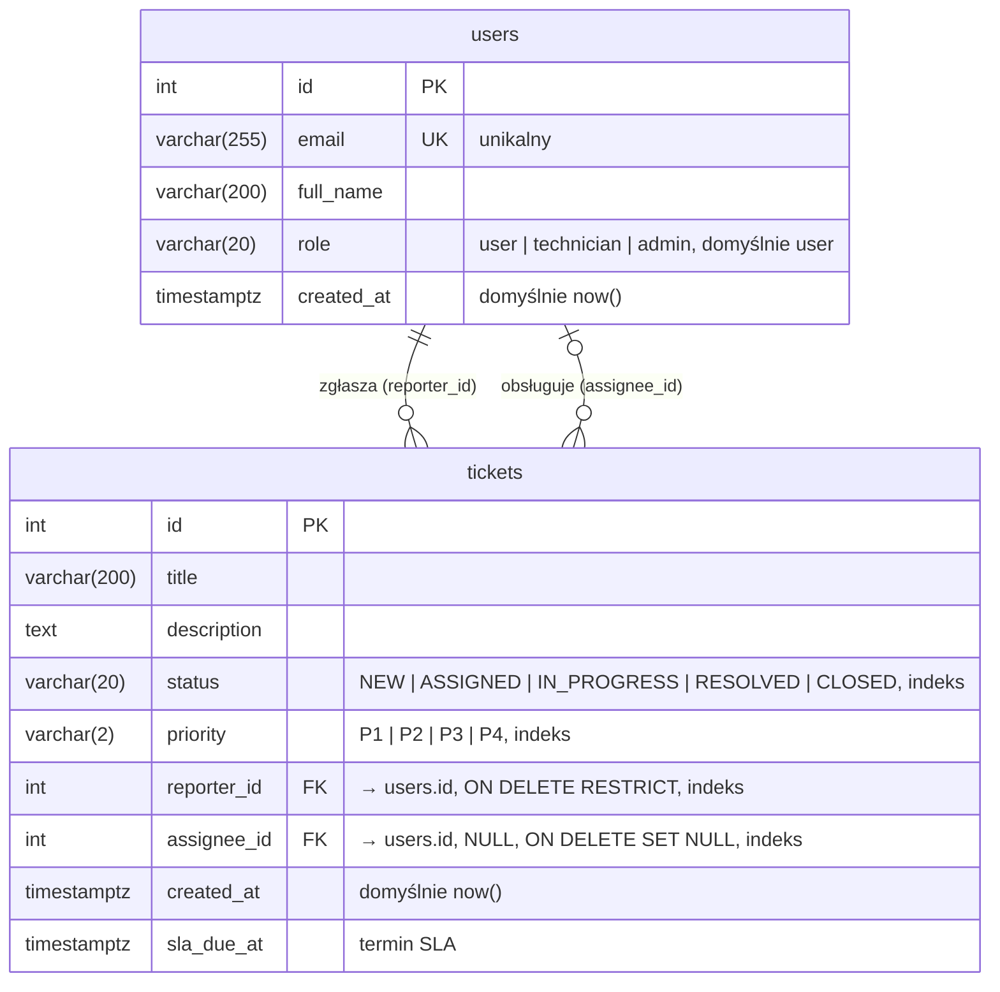

# Model danych (ERD)

Schemat bazy PostgreSQL 16. Źródło prawdy to modele SQLAlchemy w `backend/app/models/` i migracje Alembica w `backend/alembic/versions/`. Ten diagram aktualizujemy razem z każdą migracją.

## Decyzje projektowe
- **Enumy jako `VARCHAR` + `CHECK`** (a nie natywny typ `ENUM` w PostgreSQL). Nowy status czy rola to prosta migracja zmieniająca constraint, a schemat działa też na SQLite w testach.
- **Daty z strefą czasową** (`timestamptz`), zapisywane w UTC. Frontend dostaje je w ISO 8601 (`createdAt`, `slaDueAt`).
- **Usuwanie użytkownika:**
  - zgłaszającego, który ma zgłoszenia, nie da się usunąć (`RESTRICT`), bo historia musi zostać;
  - usunięcie technika zwalnia jego zgłoszenia (`SET NULL`), które wracają do puli.
- **Indeksy:**
  - `status`, `priority` dla filtrów listy;
  - `assignee_id` dla kolejki technika;
  - `reporter_id` dla widoku „moje zgłoszenia”. PostgreSQL nie zakłada indeksów na kluczach obcych sam.
- **Nazwy constraintów** wynikają ze stałej konwencji (`pk_`, `uq_`, `fk_`, `ix_`, `ck_`; `app/models/base.py`), więc kolejne migracje mogą się do nich odwoływać po nazwie.

## Mapowanie na API (dla DTO)
| Kolumna | Pole JSON we frontendzie (`frontend/src/api/types.ts`) |
|---|---|
| `tickets.id`, `title`, `description`, `status`, `priority` | `id`, `title`, `description`, `status`, `priority` |
| `tickets.reporter_id` → `users` | `reporter` (login, np. `anna.k`) |
| `tickets.assignee_id` → `users` | `assignee` (login albo `null`) |
| `tickets.created_at` | `createdAt` |
| `tickets.sla_due_at` | `slaDueAt` |

Login w danych testowych (`app/db/seed.py`) to część e-maila przed `@`. Ostateczny kształt DTO ustala backend w `app/schemas`.

## Kolejne encje (następne migracje)
Zakres zadania #9 obejmuje jeszcze: `ticket_history` (audyt zmian statusu), `comments`, `attachments` (Blob Storage) i `ai_conversations` (czat z asystentem).
