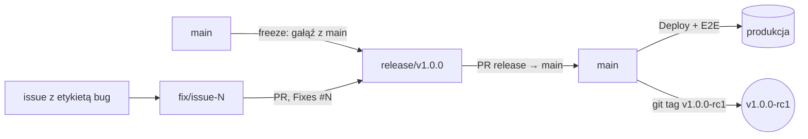

# Wydanie v1.0.0 – code freeze, poprawki i tag (Blok 12)

Od code freeze do finału (06.12) nie dodajemy nowych funkcji. Stabilizujemy to, co jest, i wydajemy wersję kandydującą `v1.0.0-rc1`.

## Zasady
- **Code freeze** zaczyna się, gdy na `main` są logowanie (#14) i asystent AI (#15). Wtedy PM zakłada gałąź `release/v1.0.0` z bieżącego `main`.
- Po freeze do `release/v1.0.0` wchodzą **tylko poprawki zgłoszonych błędów**. Każda ma issue z etykietą `bug` (lub `critical`), gałąź `fix/issue-N` z `release/v1.0.0` i PR do `release/v1.0.0` z `Fixes #N`.
- Bez nowych funkcji, refaktoryzacji „przy okazji” i podbijania zależności (wyjątek: poprawka bezpieczeństwa). Lepiej mniej, ale pewnie.
- Testy, README i dokumentacja (Blok 13) nie są funkcjami i mogą wchodzić normalnie.
- Produkcja wdraża się **tylko z `main`** (`deploy.yml`). Po zebraniu poprawek PM otwiera PR `release/v1.0.0` → `main`. Po merge Deploy wdraża je i uruchamia testy E2E.



## Ochrona `release/v1.0.0`
Taka sama jak `main`:
- merge tylko przez PR z approve innej osoby; nowy commit unieważnia approve;
- wymagane checki CI: Sekrety (Gitleaks), Frontend, Backend, Migracje, Podatności zależności (Trivy). Od tego PR `ci.yml` uruchamia się także dla `release/**`;
- bez force push i bez usuwania gałęzi.

## Kroki PM
1. **Przed freeze:** porządki na tablicy. Wszystko zrobione jest zamknięte, a to, czego nie zrobimy, dostaje etykietę `v2.0` i trafia do backlogu.
2. **Freeze:**
   ```bash
   git switch main && git pull
   git switch -c release/v1.0.0 && git push -u origin release/v1.0.0
   ```
   Potem włączyć ochronę gałęzi (jak wyżej) i ogłosić freeze zespołowi.
3. **Bug bash (#103):** każdy znaleziony błąd ląduje jako issue z etykietą `bug`. Poprawki idą przez `fix/issue-N` → PR do `release/v1.0.0`.
4. **Wydanie:** PR `release/v1.0.0` → `main`, merge, zielony Deploy i E2E. Potem tag na commicie wdrożonym na produkcję:
   ```bash
   git switch main && git pull
   git tag -a v1.0.0-rc1 -m "CloudDesk v1.0.0-rc1 – wersja kandydująca po code freeze"
   git push origin v1.0.0-rc1
   ```
5. **Release Notes:** GitHub → Releases → *Draft a new release* → tag `v1.0.0-rc1`, zaznaczone *Set as a pre-release*. Treść według wzoru niżej.
6. **Sprawdzenie:** `/api/health` → `commit` = SHA tagu (`git rev-list -n1 v1.0.0-rc1`).

## Wzór Release Notes
```markdown
## CloudDesk v1.0.0-rc1

Wersja kandydująca po code freeze (Blok 12). Aplikacja: https://clouddesk-qubit.polandcentral.cloudapp.azure.com

### Funkcje
- Zgłoszenia IT: lista z filtrami, wyszukiwaniem i paginacją, szczegóły, dodawanie, edycja, usuwanie, historia zmian, SLA wg priorytetu
- Logowanie (JWT) i role: zgłaszający, technik, administrator
- Asystent AI (Azure OpenAI) w szczególe zgłoszenia

### Poprawki po code freeze
- #N – krótki opis (każdy PR z `Fixes #N` do release/v1.0.0)

### Infrastruktura i jakość
- 3 warstwy w Azure (VNet 10.0.0.0/16), Terraform, HTTPS, baza bez dostępu publicznego, SSH zamknięty
- CI: Gitleaks, Trivy, CodeQL, lint, testy, migracje; CD przez OIDC z testami E2E po wdrożeniu
- Monitoring: /health, Log Analytics, dashboard, budżet z alertami 50/80/100%

### Znane ograniczenia
- Wspólne hasło kont demo; token ważny 60 min bez możliwości unieważnienia
- Pierwsze żądanie po przerwie trwa do ~20 s (backend skaluje się do zera)
- …
```
