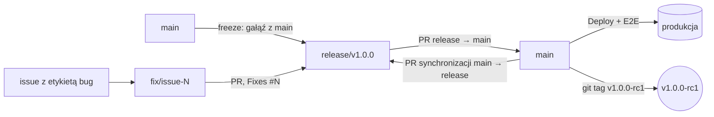

# Wydanie v1.0.0 – code freeze, poprawki i tag (Blok 12)

Od code freeze do finału (06.12) nie dodajemy nowych funkcji. Stabilizujemy to, co jest, i wydajemy wersję kandydującą `v1.0.0-rc1`.

## Zasady
- **Code freeze** zaczyna się, gdy na `main` są logowanie (#14) i asystent AI (#15). Wtedy PM zakłada gałąź `release/v1.0.0` z bieżącego `main`.
- Po freeze do `release/v1.0.0` wchodzą **tylko poprawki zgłoszonych błędów**. Każda ma issue z etykietą `bug` (lub `critical`), gałąź `fix/issue-N` z `release/v1.0.0` i PR do `release/v1.0.0` z `Fixes #N`.
  - GitHub zamyka issue automatycznie tylko przy merge do `main`. Dlatego PM zamyka je ręcznie od razu po merge poprawki: `gh issue close N -c "Poprawione w #PR (release/v1.0.0)"`. W opisie PR `release/v1.0.0` → `main` wypisujemy wszystkie `Fixes #N`.
- Bez nowych funkcji, refaktoryzacji „przy okazji” i podbijania zależności (wyjątek: poprawka bezpieczeństwa). Lepiej mniej, ale pewnie.
- Produkcja wdraża się **tylko z `main`** (`deploy.yml`), więc w czasie freeze `main` też jest zamrożony. Do `main` wchodzą wyłącznie:
  - PR `release/v1.0.0` → `main`;
  - testy (Blok 11) i dokumentacja (Blok 13), bo nie są funkcjami.

  Takie PR-y zatwierdza PM. PR-y Dependabota czekają do po finale (06.12); wyjątkiem są poprawki bezpieczeństwa i tylko przez `release/v1.0.0`.
- Po zebraniu poprawek PM otwiera PR `release/v1.0.0` → `main`. Po merge Deploy wdraża zmiany i sprawdza stronę, SHA i `/api/health`, a po #100 uruchamia też testy API i E2E (job `e2e-tests`).



## Ochrona `release/**`
Ruleset repozytorium „Gałęzie wydań” obejmuje każdą gałąź `release/**`. Jest ustawiony **zanim** gałąź powstanie, więc nie ma okna bez ochrony. Zasady:
- merge tylko przez PR z approve innej osoby; nowy commit unieważnia approve;
- wymagane checki CI (dokładne nazwy jobów z `ci.yml`): `Sekrety (Gitleaks)`, `Frontend (lint + build)`, `Backend (ruff + pytest)`, `Migracje (PostgreSQL 16)`, `Podatności zależności (Trivy)`. Od tego PR `ci.yml` uruchamia się także dla `release/**`;
- bez force push i **bez usuwania gałęzi**. Repo ma automatyczne usuwanie gałęzi po merge, a ruleset to blokuje, więc `release/v1.0.0` zostaje na rc2.

## Kroki PM
1. **Przed freeze:** porządki na tablicy. Wszystko zrobione jest zamknięte, a to, czego nie zrobimy, dostaje etykietę `v2.0` i trafia do backlogu. Etykieta już istnieje.
2. **Freeze:**
   ```bash
   git switch main && git pull
   git switch -c release/v1.0.0 && git push -u origin release/v1.0.0
   ```
   Ochrona działa od razu (ruleset). Zostaje ogłosić freeze zespołowi.
3. **Bug bash (#103):** każdy znaleziony błąd ląduje jako issue z etykietą `bug`. Poprawki idą przez `fix/issue-N` → PR do `release/v1.0.0`.
4. **Wydanie:** PR `release/v1.0.0` → `main` (squash) i merge. Czekamy na zielony Deploy.
5. **Synchronizacja:** repo scala tylko przez squash, więc commity z `release/v1.0.0` nie trafiają do historii `main`. Zaraz po merge otwieramy PR `main` → `release/v1.0.0` (zwykły merge, bez zmian w kodzie). Bez tego kolejny PR release → `main` pokazałby stare poprawki jeszcze raz i miałby konflikty.
6. **Tag** stawiamy na **dokładnym commicie merge PR-a release**, a nie na tym, co akurat jest na `main` (w międzyczasie mógł wejść np. PR z README):
   ```bash
   git fetch origin
   sha=$(gh pr view <nr PR release→main> --json mergeCommit --jq .mergeCommit.oid)
   git tag -a v1.0.0-rc1 "$sha" -m "CloudDesk v1.0.0-rc1 – wersja kandydująca po code freeze"
   git push origin v1.0.0-rc1
   ```
7. **Release Notes:** GitHub → Releases → *Draft a new release* → tag `v1.0.0-rc1`, zaznaczone *Set as a pre-release*. Treść według wzoru niżej.
8. **Sprawdzenie:** `/api/health` → `commit` = SHA tagu (`git rev-list -n1 v1.0.0-rc1`). Jeśli po tagu wszedł jeszcze PR z dokumentacją, produkcja ma nowszy commit. To w porządku, o ile różnica to sama dokumentacja.

## Wzór Release Notes
```markdown
## CloudDesk v1.0.0-rc1

Wersja kandydująca po code freeze (Blok 12). Aplikacja: https://clouddesk-qubit.polandcentral.cloudapp.azure.com <!-- https po wdrożeniu #93; wcześniej http:// -->

### Funkcje
- Zgłoszenia IT: lista z filtrami, wyszukiwaniem i paginacją, szczegóły, dodawanie, edycja, usuwanie, historia zmian, SLA wg priorytetu
- Logowanie (JWT) i role: zgłaszający, technik, administrator
- Asystent AI (Azure OpenAI) w szczególe zgłoszenia

### Poprawki po code freeze
- #N – krótki opis (każdy PR z `Fixes #N` do release/v1.0.0)

### Infrastruktura i jakość
- 3 warstwy w Azure (VNet 10.0.0.0/16), Terraform, HTTPS, baza bez dostępu publicznego, SSH zamknięty
- CI: Gitleaks, Trivy, CodeQL, lint, testy, migracje; CD przez OIDC ze sprawdzeniem wdrożenia (i testami API/E2E po #100)
- Monitoring: /health, Log Analytics, dashboard, budżet z alertami 50/80/100%

### Znane ograniczenia
- Wspólne hasło kont demo; token ważny 60 min bez możliwości unieważnienia
- Pierwsze żądanie po przerwie trwa do ~20 s (backend skaluje się do zera)
- …
```
