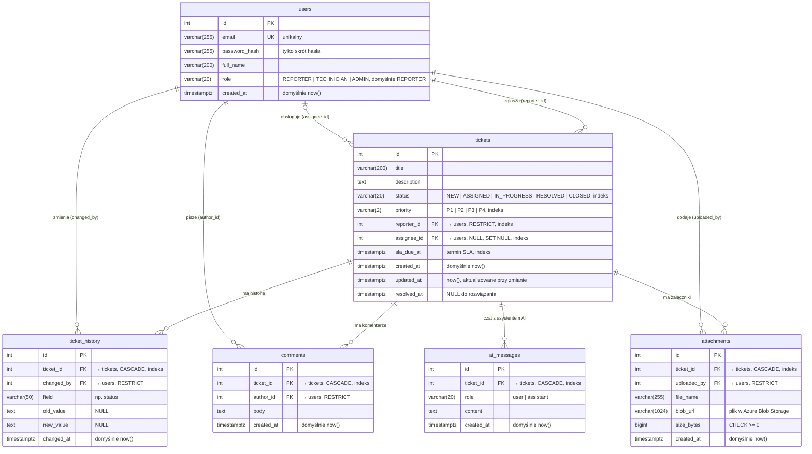

# Model danych (ERD)

Schemat bazy PostgreSQL 16. Źródło prawdy to modele SQLAlchemy w `backend/app/models/` i migracje Alembica w `backend/alembic/versions/`. Ten diagram aktualizujemy razem z każdą migracją.

## Decyzje projektowe
- **Enumy jako `VARCHAR` + `CHECK`** (a nie natywny typ `ENUM` w PostgreSQL). Nowy status czy rola to prosta migracja zmieniająca constraint, a schemat działa też na SQLite w testach.
- **Daty ze strefą czasową** (`timestamptz`), zapisywane w UTC. Frontend dostaje je w ISO 8601 (`createdAt`, `slaDueAt`).
- **Usuwanie (`ON DELETE`):**
  - zgłoszenie pociąga za sobą swoją historię, komentarze, załączniki i czat AI (`CASCADE`);
  - użytkownika, który coś zgłosił, zmienił, skomentował lub dodał, nie da się usunąć (`RESTRICT`), bo audyt musi zostać kompletny;
  - usunięcie technika zwalnia jego zgłoszenia (`SET NULL` na `assignee_id`), które wracają do puli.
- **Indeksy:**
  - `status`, `priority`, `sla_due_at` dla filtrów i sortowania listy (np. „SLA zagrożone”);
  - `assignee_id` dla kolejki technika;
  - `reporter_id` dla widoku „moje zgłoszenia”;
  - `ticket_id` w tabelach zależnych dla widoku szczegółów zgłoszenia.
  PostgreSQL nie zakłada indeksów na kluczach obcych sam.
- **Hasła:** w bazie jest wyłącznie `password_hash`. Konta z danych testowych mają nieużywalny skrót `!`, więc nie da się na nie zalogować, dopóki moduł logowania nie ustawi hasła.
- **Nazwy constraintów** wynikają ze stałej konwencji (`pk_`, `uq_`, `fk_`, `ix_`, `ck_`; `app/models/base.py`), więc kolejne migracje mogą się do nich odwoływać po nazwie.

## Mapowanie na API (dla DTO)
| Kolumna | Pole JSON we frontendzie (`frontend/src/api/types.ts`) |
|---|---|
| `tickets.id`, `title`, `description`, `status`, `priority` | `id`, `title`, `description`, `status`, `priority` |
| `tickets.reporter_id` → `users` | `reporter` (login, np. `anna.k`) |
| `tickets.assignee_id` → `users` | `assignee` (login albo `null`) |
| `tickets.created_at` | `createdAt` |
| `tickets.sla_due_at` | `slaDueAt` |

Login w danych testowych (`backend/app/db/seed.py`) to część e-maila przed `@`. Ostateczny kształt DTO ustala backend w `app/schemas`.
